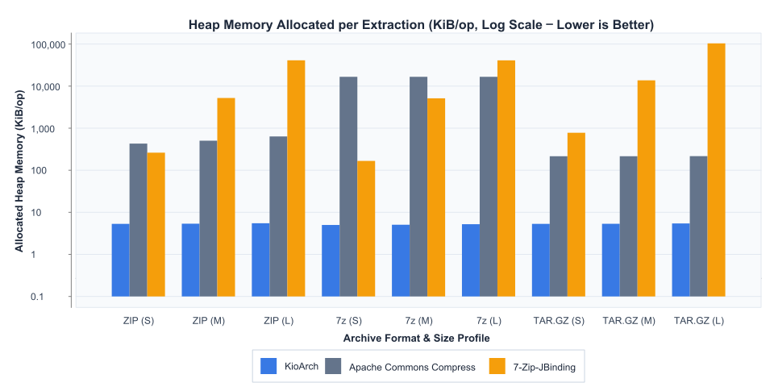
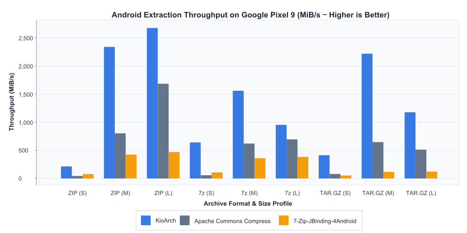
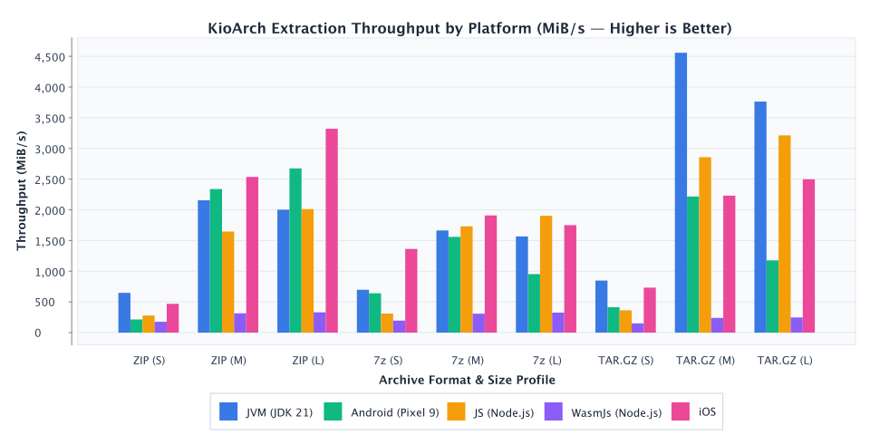

# KioArch

[](https://kotlinlang.org)
[](https://search.maven.org)
[](#)
[](#)

[English](README.md) | **日本語**

KioArch は、一時ファイルを作らずにアーカイブをオンデマンド展開する Kotlin Multiplatform (KMP) ライブラリである。7-Zip Core と miniz の C ネイティブエンジンを内蔵し、`kotlinx.io.Source` / `kotlinx.io.Sink` を介してメモリバッファやストリームへ直接データを流し込む。チャンク単位で順次デコードするため、数ギガバイト規模のアーカイブを扱う場合でもヒープメモリ消費量は $O(1)$ に保たれる。

ネイティブ共有ライブラリ（`.dll`、`.so`、`.dylib`）や WebAssembly モジュールはビルド時に自動でパッケージング・ロードされる。`7zip` と `miniz` のソースツリーには手を加えず Git サブモジュールとして分離しており、アップストリームの更新にそのまま追従できる構造をとる。

## 対応環境と仕様

| プラットフォーム | ターゲット / アーキテクチャ | 実装・配布形態 |
| :--- | :--- | :--- |
| **JVM (Desktop / Server)** | Windows (`x64`), macOS (`Universal`), Linux (`x64`) | 同梱されたネイティブライブラリを実行時に自動展開・ロード |
| **Android** | `armeabi-v7a`, `arm64-v8a`, `x86`, `x86_64` | 16 KB ページサイズ（Android 15+）対応、Jetpack App Startup 連携 |
| **iOS** | iOS Device (`arm64`), iOS Simulator (`x64`, `arm64`) | 静的 C++ ライブラリを内包した XCFramework / `.klib` |
| **JS / WasmJs** | Node.js, Browser | Emscripten でコンパイルされた WebAssembly モジュール |

アーカイブ形式の判別にはファイル拡張子を使わず、ストリーム先頭のマジックバイトを検査する。呼び出し側は `.7z`、`.zip`（`.apk`・`.jar`・`.aar`・`.epub` などの ZIP 互換形式を含む）、`.tar.gz` / `.tgz` の違いを意識せず、単一の API で扱える。

現バージョンは読み取り（展開）専用であり、アーカイブの作成や圧縮には対応していない。対応する展開アルゴリズムは、ZIP が `Deflate` と `Store`（無圧縮）、7z が `LZMA`・`LZMA2`・`PPMd`（および `BCJ` / `BCJ2` / `ARM` / `ARM64` / `IA64` / `Delta` フィルタ）、Tar/Gzip が `Gzip (Deflate)` による標準 `ustar` エントリのストリーミング展開となる。

Windows 環境で作られた ZIP アーカイブには、ファイル名が Shift_JIS (CP932) で記録されているものが少なくない。KioArch は全プラットフォームで文字コードの自動判別を備えており、UTF-8 として不正なバイト列を検出した際は Shift_JIS へフォールバックして文字化けを防ぐ。

## 使い方

### JVM

`java.io.File` や `java.nio.file.Path` からリーダーを生成し、必要なエントリだけを任意の `kotlinx.io.Sink` へ書き出す。

```kotlin
import com.sorrowblue.kioarch.KioArch
import com.sorrowblue.kioarch.createReader
import kotlinx.io.asSink
import java.io.File
import java.io.FileOutputStream

val archiveFile = File("path/to/archive.7z")

KioArch.createReader(archiveFile).use { reader ->
    val entries = reader.getEntries()
    val targetEntry = entries.first { !it.isDirectory && it.name == "notes.txt" }

    FileOutputStream(File("extracted_notes.txt")).use { outputStream ->
        val sink = outputStream.asSink()
        reader.extractEntry(targetEntry, sink)
        sink.flush()
    }
}
```

### Android

Storage Access Framework 等で取得した Content `Uri` に対しても、キャッシュ領域へコピーすることなく `FileChannel` 経由で直接ランダムアクセス展開を行える。`DirectSeekableSource` を実装すると、JNI 境界での `ByteArray` コピーを省いたゼロコピー経路が有効になる。

```kotlin
import android.content.Context
import android.net.Uri
import com.sorrowblue.kioarch.DirectSeekableSource
import com.sorrowblue.kioarch.KioArch
import kotlinx.io.Buffer
import java.io.FileInputStream
import java.nio.ByteBuffer

class UriSeekableSource(context: Context, uri: Uri) : DirectSeekableSource {
    private val pfd = context.contentResolver.openFileDescriptor(uri, "r")!!
    private val fis = FileInputStream(pfd.fileDescriptor)
    private val channel = fis.channel

    override fun read(byteBuffer: ByteBuffer): Int = channel.read(byteBuffer)

    override fun read(buffer: ByteArray, offset: Int, length: Int): Int =
        channel.read(ByteBuffer.wrap(buffer, offset, length))

    override fun seek(position: Long) {
        channel.position(position)
    }

    override fun position(): Long = channel.position()
    override fun length(): Long = pfd.statSize

    override fun close() {
        channel.close()
        fis.close()
        pfd.close()
    }
}

fun extractFromUri(context: Context, archiveUri: Uri) {
    KioArch.createReader(UriSeekableSource(context, archiveUri)).use { reader ->
        val fileEntry = reader.getEntries().first { !it.isDirectory }
        val buffer = Buffer()
        reader.extractEntry(fileEntry, buffer)
    }
}
```

#### Android におけるネイティブライブラリのロード制御

Android 版はデフォルトで Jetpack App Startup の `KioArchInitializer` を登録し、アプリ起動時に `libkioarch.so` をプリロードする。初回展開時にメインスレッドで共有ライブラリのリンク処理が走ってフレーム落ちするのを避けるためである。

起動時間を優先してプリロードを止めたい場合は、`AndroidManifest.xml` で `KioArchInitializer` を除外したうえで、バックグラウンドスレッド等から任意のタイミングで `KioArch.loadLibrary()` を呼び出す。

```xml
<provider
    android:name="androidx.startup.InitializationProvider"
    android:authorities="${applicationId}.androidx-startup"
    android:exported="false"
    tools:node="merge"
    xmlns:tools="http://schemas.android.com/tools">
    <meta-data
        android:name="com.sorrowblue.kioarch.KioArchInitializer"
        tools:node="remove" />
</provider>
```

```kotlin
import com.sorrowblue.kioarch.KioArch

KioArch.loadLibrary()
```

> [!WARNING]
> 自動ロードを無効化したまま `KioArch.loadLibrary()` を呼ばずにアーカイブ操作を実行すると、初回呼び出し時にオンデマンドで `System.loadLibrary` が走る。UI スレッド上で実行された場合はディスク I/O とリンク処理によるブロッキングが発生するため、Logcat に警告（`KioArch JNI library is being loaded lazily on-demand.`）が出力される。

### JS / WasmJs

Web および Node.js 環境では WebAssembly のインスタンス化が非同期になるため、アーカイブ操作の前に Emscripten モジュールを渡して `KioArch.initialize(module)` を完了させておく必要がある。初期化後はメモリ上の `ByteArray` 等から同じ API で展開できる。

```kotlin
import com.sorrowblue.kioarch.KioArch
import kotlinx.io.Buffer
import kotlinx.io.readByteArray

// 1. Emscripten ローダーで Wasm モジュールを非同期ロードして初期化
val module = createKioArchModule()
KioArch.initialize(module)

// 2. インメモリの ByteArray から展開
val archiveBytes: ByteArray = getArchiveData()

KioArch.createReader(archiveBytes).use { reader ->
    val targetEntry = reader.getEntries().first { !it.isDirectory }
    val buffer = Buffer()
    reader.extractEntry(targetEntry, buffer)
    val extractedText = buffer.readByteArray().decodeToString()
}
```

## パフォーマンスとベンチマーク

JVM と Android では Direct `ByteBuffer`（`GetDirectBufferAddress`）を利用したゼロコピー JNI 転送（`DirectSeekableSource` + `extractEntryDirect`）を採用している。ネイティブ層と JVM ヒープ間で一時的な `byte[]` の確保・コピーを行わないため、アーカイブサイズが大きくなっても GC 負荷が増えない。

ベンチマークでは **KioArch** に加え、定番のアーカイブライブラリである **[Apache Commons Compress](https://commons.apache.org/proper/commons-compress/)**（7z LZMA2 用に `org.tukaani:xz` を併用）および **[7-Zip-JBinding](https://sevenzipjbinding.sourceforge.net/)**（Android 実機では 16 KB ページサイズ対応の [`7-Zip-JBinding-4Android`](https://central.sonatype.com/artifact/com.sorrowblue.sevenzipjbinding/7-Zip-JBinding-4Android)）を比較対象とした。アーカイブ内のファイル数を 20 個に固定し、1 ファイルあたりのサイズを 3 段階（`small` / `medium` / `large`）に変えて全 20 エントリを展開する。

| プロファイル | 1ファイルサイズ | ファイル数 | 合計展開サイズ / op | 想定データ |
| :---: | :---: | :---: | :---: | :--- |
| **`small`** | **4 KiB** (`4,096 B`) | **20** | **80 KiB** (`0.078 MiB`) | 設定ファイル、JSON メタデータ、小規模アセット |
| **`medium`** | **128 KiB** (`131,072 B`) | **20** | **2.50 MiB** | コミックページ (CBZ/7z)、ドキュメント、アプリバンドル |
| **`large`** | **1 MiB** (`1,048,576 B`) | **20** | **20.0 MiB** | 高解像度メディア、DB スナップショット、大容量バイナリ |

### 1. ライブラリ別 ヒープメモリ割り当て量 (JVM JMH `-prof gc`)

`Apache Commons Compress` は 7z (LZMA2) 展開時に Java ヒープ上へ約 17 MiB/op の辞書バッファを確保する。`7-Zip-JBinding` はネイティブ側で展開するものの、コールバック `ISequentialOutStream.write(byte[])` の呼び出しごとに JNI 側で新規 `byte[]` を生成するため、展開サイズに比例して数十 MiB 超のヒープ割り当て（$O(N)$）が発生する。KioArch は固定長の Direct `ByteBuffer` を使い回すため、20 MiB のアーカイブを展開しても JVM ヒープ割り当て量は **約 5.0〜5.5 KiB/op**（$O(1)$）から変動しない。



### 2. ライブラリ別 Android 実機スループット (`androidx.benchmark`)

ART の Large Object Space (LOS) への `byte[]` 割り当てを排除し、Direct `ByteBuffer` 上でのゼロコピー展開とハードウェア CRC32 命令を組み合わせることで、Android 実機（Google Pixel 9）でも全フォーマット・全サイズで高い展開スループットを発揮する。



### 3. マルチプラットフォーム展開スループット (`KioArch`)

`KioArch` 単体で各プロファイル（`small` / `medium` / `large` × `ZIP` / `7z` / `TAR.GZ`）を展開した際のプラットフォーム別スループット（JVM / Android / JS / WasmJs / iOS）。



### ベンチマークの実行とグラフ更新

`:benchmark:jvmGcBenchmark` または `:benchmark:connectedAndroidDeviceTest` を実行すると、後続タスクの `:benchmark:updateBenchmarkCharts` が自動で走り、[XChart](https://github.com/knowm/XChart) によって `docs/assets/` 配下の SVG グラフ 3 枚が再生成される。

```powershell
# JVM ベンチマーク + JMH GC プロファイラ実行 (benchmark-library-heap.svg 等を自動更新)
.\gradlew.bat :benchmark:jvmGcBenchmark

# Android 実機ベンチマーク実行 (benchmark-library-throughput.svg 等を自動更新)
.\gradlew.bat :benchmark:connectedAndroidDeviceTest

# マルチプラットフォーム スモークベンチマーク (JS / WasmJs / iOS)
.\gradlew.bat :benchmark:jsSmokeBenchmark :benchmark:wasmJsSmokeBenchmark :benchmark:iosSimulatorArm64SmokeBenchmark

# 既存のベンチマーク結果 JSON から SVG グラフ 3 枚を再生成
.\gradlew.bat :benchmark:updateBenchmarkCharts
```

## ビルドと開発環境

Gradle ビルド時に CMake が自動実行され、各ターゲット向けのネイティブバイナリがコンパイル・同梱される。

共通のビルド要件として **JDK 21 以上**と **CMake 3.22 以上**が必要となる。ターゲット別の追加要件は以下の通り。

- **JVM ネイティブビルド**: Windows では Visual Studio 2022（または Build Tools 2022）の「C++ によるデスクトップ開発」ワークロード（`MSVC v143` および `Windows 10/11 SDK`）、macOS では Xcode Command Line Tools（`xcode-select --install`）、Linux では GCC/G++ または Clang（`build-essential` 等）。
- **Android**: Android SDK と NDK をインストールし、`local.properties` に `sdk.dir` と `ndk.dir` を指定する。
- **JS / WasmJs**: Emscripten SDK (`emsdk`) をインストールし、`local.properties` に `emsdk.dir=C:\\path\\to\\emsdk` を指定する。
- **iOS**: Xcode がインストールされた macOS ホストが必要。

```powershell
# JVM ネイティブのビルドとテスト実行
.\gradlew.bat :kioarch:clean :kioarch:jvmTest

# Android 全 ABI (armeabi-v7a, arm64-v8a, x86, x86_64) のビルド
.\gradlew.bat :kioarch:assemble
```

## ライセンス

```text
Copyright 2026 SorrowBlue

Licensed under the Apache License, Version 2.0 (the "License");
you may not use this file except in compliance with the License.
You may obtain a copy of the License at

    http://www.apache.org/licenses/LICENSE-2.0

Unless required by applicable law or agreed to in writing, software
distributed under the License is distributed on an "AS IS" BASIS,
WITHOUT WARRANTIES OR CONDITIONS OF ANY KIND, either express or implied.
See the License for the specific language governing permissions and
limitations under the License.
```
