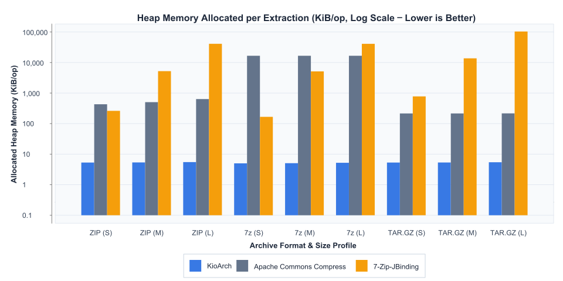
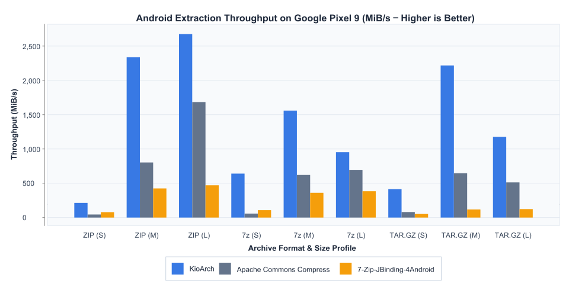
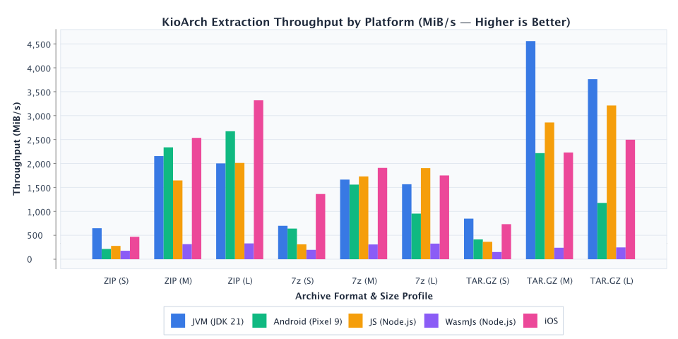

# KioArch

[](https://kotlinlang.org)
[](https://search.maven.org)
[](https://sorrowblue.github.io/KioArch/)
[](#)
[](#)

**English** | [日本語](README.ja.md)

KioArch is a Kotlin Multiplatform (KMP) library for on-demand archive extraction without temporary files. Built on top of the C native engines from **7-Zip Core** and **miniz**, it streams decompressed chunks directly from `SeekableSource` into `kotlinx.io.Sink` while keeping heap memory overhead at $O(1)$ regardless of archive size.

Native shared libraries (`.dll`, `.so`, `.dylib`) and WebAssembly binaries are built, packaged, and loaded automatically. Both `7zip` and `miniz` are maintained as unmodified Git submodules so upstream updates can be tracked cleanly.

## Supported Platforms & Formats

| Platform | Targets / Architectures | Packaging & Runtime |
| :--- | :--- | :--- |
| **JVM (Desktop / Server)** | Windows (`x64`), macOS (`Universal`), Linux (`x64`) | Extracts and loads embedded native libraries at runtime |
| **Android** | `armeabi-v7a`, `arm64-v8a`, `x86`, `x86_64` | 16 KB page size ready (Android 15+), integrated with Jetpack App Startup |
| **iOS** | iOS Device (`arm64`), iOS Simulator (`x64`, `arm64`) | Distributed as XCFramework / `.klib` with embedded static C++ libraries |
| **JS / WasmJs** | Node.js, Browser | Powered by Emscripten WebAssembly |

KioArch identifies archive formats by inspecting magic bytes at the start of the stream rather than relying on file extensions. `.7z`, `.zip` (including ZIP-based containers such as `.apk`, `.jar`, `.aar`, and `.epub`), and `.tar.gz` / `.tgz` archives are all handled through the same reader API.

The library is strictly read-only and does not support creating or modifying archives. Supported decoders include `Deflate` and `Store` for ZIP (via miniz), `LZMA`, `LZMA2`, and `PPMd` with `BCJ` / `BCJ2` / `ARM` / `ARM64` / `IA64` / `Delta` filters for 7z (via 7-Zip Core), and streaming `Gzip (Deflate)` decompression for standard `ustar` Tar archives.

ZIP archives created on Windows frequently store Japanese filenames in Shift_JIS (CP932) without setting the UTF-8 general purpose bit flag. KioArch validates filename byte sequences across all targets and automatically falls back from UTF-8 to Shift_JIS when invalid UTF-8 sequences are encountered.

## Usage

### JVM

Create a reader from a `java.io.File` or `java.nio.file.Path` and stream target entries into any `kotlinx.io.Sink`.

```kotlin
import com.sorrowblue.kioarch.KioArch
import com.sorrowblue.kioarch.createReader
import kotlinx.io.asSink
import java.io.File
import java.io.FileOutputStream

val archiveFile = File("path/to/archive.7z")

KioArch.createReader(archiveFile).use { reader ->
    val entries = reader.getEntries()
    val targetEntry = entries.first { !it.isDirectory && it.name == "notes.txt" }

    FileOutputStream(File("extracted_notes.txt")).use { outputStream ->
        val sink = outputStream.asSink()
        reader.extractEntry(targetEntry, sink)
        sink.flush()
    }
}
```

### Android

Archives selected via the Storage Access Framework (`content://` `Uri`) can be read in place over a `FileChannel` without copying the file into cache storage. Implementing `DirectSeekableSource` enables zero-copy JNI reads through a direct `ByteBuffer`.

```kotlin
import android.content.Context
import android.net.Uri
import com.sorrowblue.kioarch.DirectSeekableSource
import com.sorrowblue.kioarch.KioArch
import kotlinx.io.Buffer
import java.io.FileInputStream
import java.nio.ByteBuffer

class UriSeekableSource(context: Context, uri: Uri) : DirectSeekableSource {
    private val pfd = context.contentResolver.openFileDescriptor(uri, "r")!!
    private val fis = FileInputStream(pfd.fileDescriptor)
    private val channel = fis.channel

    override fun read(byteBuffer: ByteBuffer): Int = channel.read(byteBuffer)

    override fun read(buffer: ByteArray, offset: Int, length: Int): Int =
        channel.read(ByteBuffer.wrap(buffer, offset, length))

    override fun seek(position: Long) {
        channel.position(position)
    }

    override fun position(): Long = channel.position()
    override fun length(): Long = pfd.statSize

    override fun close() {
        channel.close()
        fis.close()
        pfd.close()
    }
}

fun extractFromUri(context: Context, archiveUri: Uri) {
    KioArch.createReader(UriSeekableSource(context, archiveUri)).use { reader ->
        val fileEntry = reader.getEntries().first { !it.isDirectory }
        val buffer = Buffer()
        reader.extractEntry(fileEntry, buffer)
    }
}
```

#### Native Library Loading on Android

On Android, KioArch registers `KioArchInitializer` with Jetpack App Startup to preload `libkioarch.so` at app launch, avoiding disk I/O and linker pauses on the first archive operation.

If you prefer to defer loading until a background initialization step, remove `KioArchInitializer` in your `AndroidManifest.xml` and call `KioArch.loadLibrary()` explicitly before opening an archive:

```xml
<provider
    android:name="androidx.startup.InitializationProvider"
    android:authorities="${applicationId}.androidx-startup"
    android:exported="false"
    tools:node="merge"
    xmlns:tools="http://schemas.android.com/tools">
    <meta-data
        android:name="com.sorrowblue.kioarch.KioArchInitializer"
        tools:node="remove" />
</provider>
```

```kotlin
import com.sorrowblue.kioarch.KioArch

KioArch.loadLibrary()
```

> [!WARNING]
> If automatic initialization is disabled and an archive operation is invoked before `KioArch.loadLibrary()`, KioArch falls back to on-demand loading and logs a warning (`KioArch JNI library is being loaded lazily on-demand.`). Calling this path on the main thread can cause frame drops while the native library is linked.

### JS / WasmJs

Because WebAssembly instantiation is asynchronous in browsers and Node.js, pass the loaded Emscripten module instance to `KioArch.initialize(module)` before creating a reader. Once initialized, archives can be read directly from in-memory `ByteArray` buffers.

```kotlin
import com.sorrowblue.kioarch.KioArch
import kotlinx.io.Buffer
import kotlinx.io.readByteArray

// 1. Load the Emscripten Wasm module asynchronously and initialize KioArch
val module = createKioArchModule()
KioArch.initialize(module)

// 2. Extract from an in-memory ByteArray
val archiveBytes: ByteArray = getArchiveData()

KioArch.createReader(archiveBytes).use { reader ->
    val targetEntry = reader.getEntries().first { !it.isDirectory }
    val buffer = Buffer()
    reader.extractEntry(targetEntry, buffer)
    val extractedText = buffer.readByteArray().decodeToString()
}
```

## Performance & Benchmarks

On JVM and Android, KioArch transfers data across the JNI boundary using direct `ByteBuffer` addresses (`GetDirectBufferAddress`) via `DirectSeekableSource` and `extractEntryDirect`. Bypassing intermediate `byte[]` copies keeps JVM and ART heap allocations constant even when extracting multi-megabyte archives.

The benchmark suite compares **KioArch** against **[Apache Commons Compress](https://commons.apache.org/proper/commons-compress/)** (backed by `org.tukaani:xz` for LZMA2) and **[7-Zip-JBinding](https://sevenzipjbinding.sourceforge.net/)** ([`7-Zip-JBinding-4Android`](https://central.sonatype.com/artifact/com.sorrowblue.sevenzipjbinding/7-Zip-JBinding-4Android) on Android). Each benchmark operation extracts all 20 entries in an archive across three entry-size profiles:

| Profile | Per-File Size | File Count | Total Extracted per Op | Typical Workload |
| :---: | :---: | :---: | :---: | :--- |
| **`small`** | **4 KiB** (`4,096 B`) | **20** | **80 KiB** (`0.078 MiB`) | Config files, JSON metadata, small assets |
| **`medium`** | **128 KiB** (`131,072 B`) | **20** | **2.50 MiB** | Comic pages (CBZ/7z), documents, app bundles |
| **`large`** | **1 MiB** (`1,048,576 B`) | **20** | **20.0 MiB** | High-resolution media, database snapshots, large binaries |

### 1. Library Comparison: Heap Memory Footprint (JVM JMH `-prof gc`)

`Apache Commons Compress` allocates Java-heap dictionary buffers (~17 MiB/op for 7z LZMA2), while `7-Zip-JBinding` allocates a new `byte[]` on the JVM heap for every decompressed chunk passed to `ISequentialOutStream.write(byte[])`, scaling linearly ($O(N)$) with archive size. KioArch reuses a single native-backed direct `ByteBuffer` per reader and keeps heap allocations flat at **~5.0–5.5 KiB/op** ($O(1)$) across all formats and archive sizes:



### 2. Library Comparison: Android Real-Device Throughput (`androidx.benchmark`)

Avoiding `byte[]` allocations in ART's Large Object Space (LOS) and decoding directly into direct `ByteBuffer` memory with hardware-accelerated CRC32 delivers top extraction throughput across all formats and sizes on Android devices:



### 3. Multiplatform Extraction Throughput (`KioArch`)

Throughput of the `KioArch` extraction engine (`small` / `medium` / `large` profiles across `ZIP`, `7z`, and `TAR.GZ`) across supported Kotlin Multiplatform targets:



### Running Benchmarks & Updating Charts

Running `:benchmark:jvmGcBenchmark` or `:benchmark:connectedAndroidDeviceTest` automatically invokes `:benchmark:updateBenchmarkCharts`, which regenerates all three SVG charts in `docs/assets/` using [XChart](https://github.com/knowm/XChart):

```powershell
# JVM benchmark with JMH GC profiler (updates benchmark-library-heap.svg & benchmark-platform-throughput.svg)
.\gradlew.bat :benchmark:jvmGcBenchmark

# Android real-device benchmark (updates benchmark-library-throughput.svg & benchmark-platform-throughput.svg)
.\gradlew.bat :benchmark:connectedAndroidDeviceTest

# Multiplatform smoke benchmarks (JS / WasmJs / iOS)
.\gradlew.bat :benchmark:jsSmokeBenchmark :benchmark:wasmJsSmokeBenchmark :benchmark:iosSimulatorArm64SmokeBenchmark

# Regenerate SVG charts from existing benchmark JSON reports
.\gradlew.bat :benchmark:updateBenchmarkCharts
```

## Build & Development

Gradle automatically runs CMake during the build to compile and package native binaries for the active target platforms.

Building from source requires **JDK 21+** and **CMake 3.22+**, along with the toolchain for your target platforms:

- **JVM Native**: Visual Studio 2022 (or Build Tools 2022) with the "Desktop development with C++" workload (`MSVC v143` and `Windows 10/11 SDK`) on Windows; Xcode Command Line Tools (`xcode-select --install`) on macOS; GCC/G++ or Clang (`build-essential`) on Linux.
- **Android**: Android SDK and NDK configured via `sdk.dir` and `ndk.dir` in `local.properties`.
- **JS / WasmJs**: Emscripten SDK (`emsdk`) configured via `emsdk.dir=C:\\path\\to\\emsdk` in `local.properties`.
- **iOS**: macOS host with Xcode installed.

```powershell
# Build JVM natives and run the JVM test suite
.\gradlew.bat :kioarch:clean :kioarch:jvmTest

# Cross-compile Android native ABIs (armeabi-v7a, arm64-v8a, x86, x86_64)
.\gradlew.bat :kioarch:assemble
```

## License

```text
Copyright 2026 SorrowBlue

Licensed under the Apache License, Version 2.0 (the "License");
you may not use this file except in compliance with the License.
You may obtain a copy of the License at

    http://www.apache.org/licenses/LICENSE-2.0

Unless required by applicable law or agreed to in writing, software
distributed under the License is distributed on an "AS IS" BASIS,
WITHOUT WARRANTIES OR CONDITIONS OF ANY KIND, either express or implied.
See the License for the specific language governing permissions and
limitations under the License.
```
