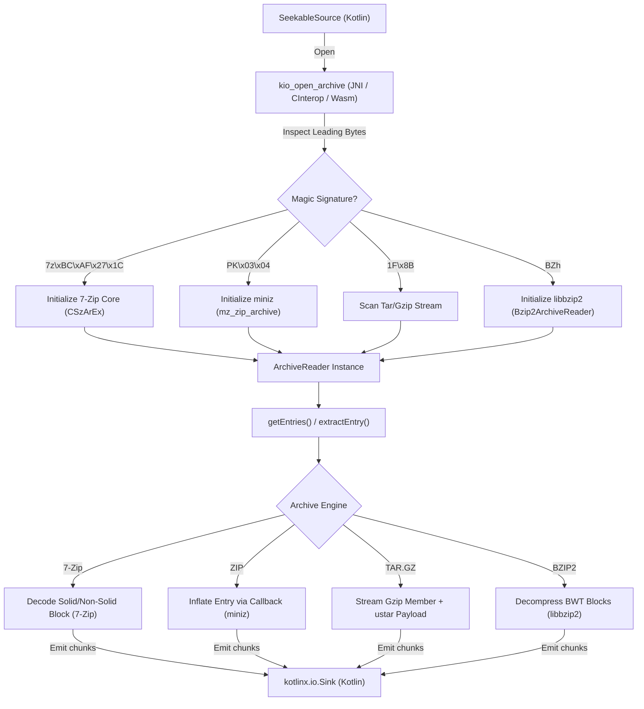

# Architecture

KioArch is designed around a streaming, callback-driven bridge between Kotlin Multiplatform I/O abstractions and battle-tested C decompression engines.

---

## Streaming Data Flow

Instead of extracting files to temporary disk directories, KioArch passes random-access read/seek callbacks down to the native layer and streams decompressed blocks back into a [`kotlinx.io.Sink`](https://kotlinlang.org/api/kotlinx-io/kotlinx-io-core/kotlinx.io/-sink/index.html):

---

## Memory Management & Zero-Copy Transfers

### Constant Heap Overhead

Traditional archive wrappers often allocate a contiguous `ByteArray` equal to the uncompressed size of an entry. KioArch avoids this by allocating a fixed native transfer buffer and invoking the Kotlin sink callback repeatedly as chunks are decoded.

### Direct `ByteBuffer` Bridge on JVM & Android

On JVM and Android, implementing [`DirectSeekableSource`](api/-kio-arch/com.sorrowblue.kioarch/-direct-seekable-source/index.html) allows the C++ JNI bridge to wrap its native read buffer with `NewDirectByteBuffer` and invoke `DirectSeekableSource.read(ByteBuffer)` directly.

1. The native decoder requests $N$ bytes at offset $P$.
2. JNI creates a scoped direct `ByteBuffer` pointing to the native buffer and immediately releases the local reference via `DeleteLocalRef` after the call.
3. If a JVM exception is thrown inside the Kotlin `SeekableSource` or `Sink` callback, the JNI layer detects it via `ExceptionCheck(env)`, aborts decompression immediately, frees all native decoder allocations, and propagates the exception back to Kotlin.

---

## Thread Safety & Resource Lifecycle

- **Synchronized Handle Access**: Native archive handles (`CSzArEx`, `mz_zip_archive`, and stream states) maintain mutable cursor and dictionary state. All platform [`ArchiveReader`](api/-kio-arch/com.sorrowblue.kioarch/-archive-reader/index.html) implementations synchronize access to the native handle using platform locks so concurrent calls from multiple threads do not corrupt native memory.
- **No Re-Entrancy from Callbacks**: Because extraction holds the reader lock for the duration of `extractEntry`, custom `SeekableSource` or `Sink` implementations must not invoke methods on the same `ArchiveReader` instance from inside their `read` or `write` callbacks.
- **Deterministic Cleanup**: Calling [`ArchiveReader.close()`](api/-kio-arch/com.sorrowblue.kioarch/-archive-reader/index.html) frees all native C structures (or WebAssembly heap pointers and registered function table entries) and closes the underlying [`SeekableSource`](api/-kio-arch/com.sorrowblue.kioarch/-seekable-source/index.html). Calling `close()` multiple times is idempotent.
